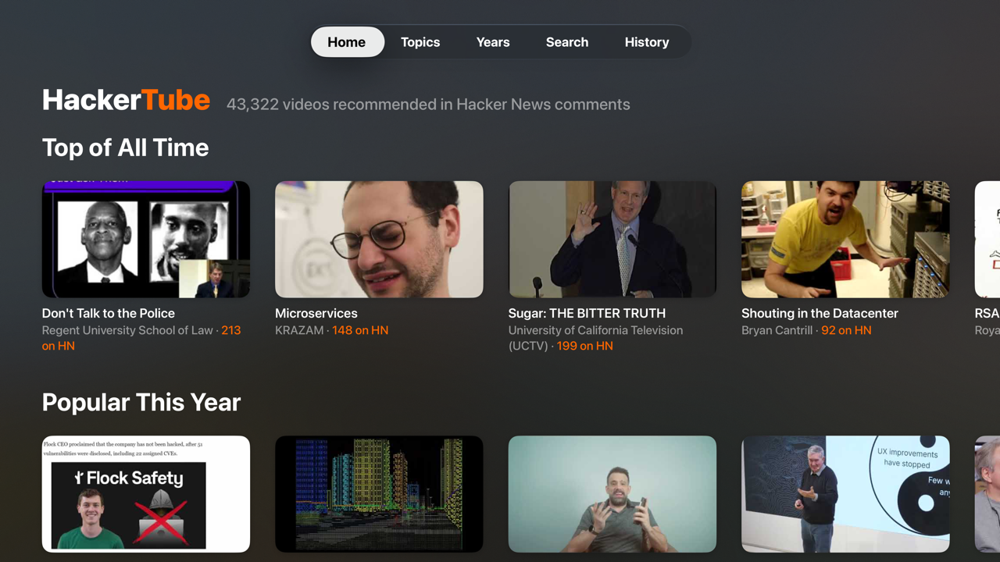
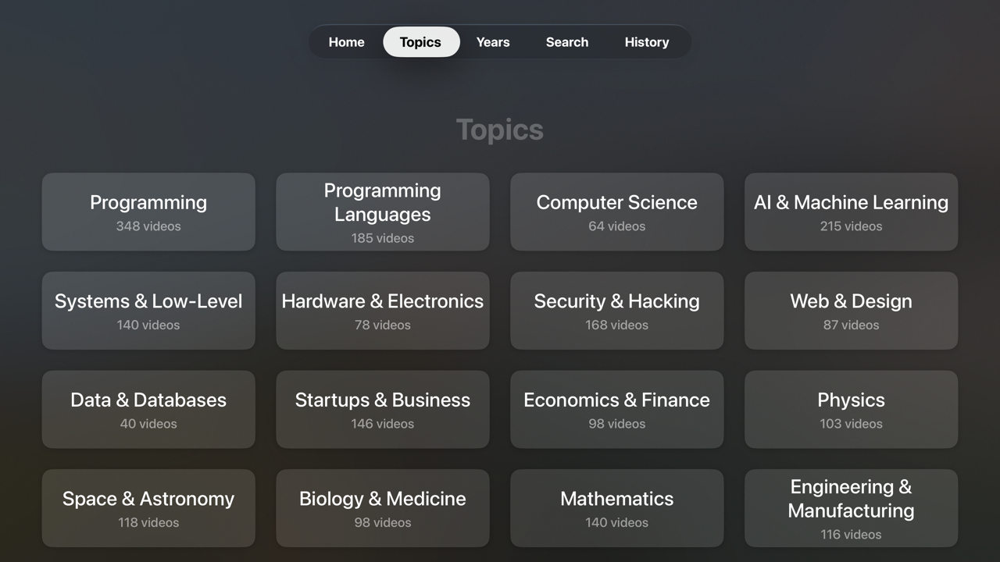
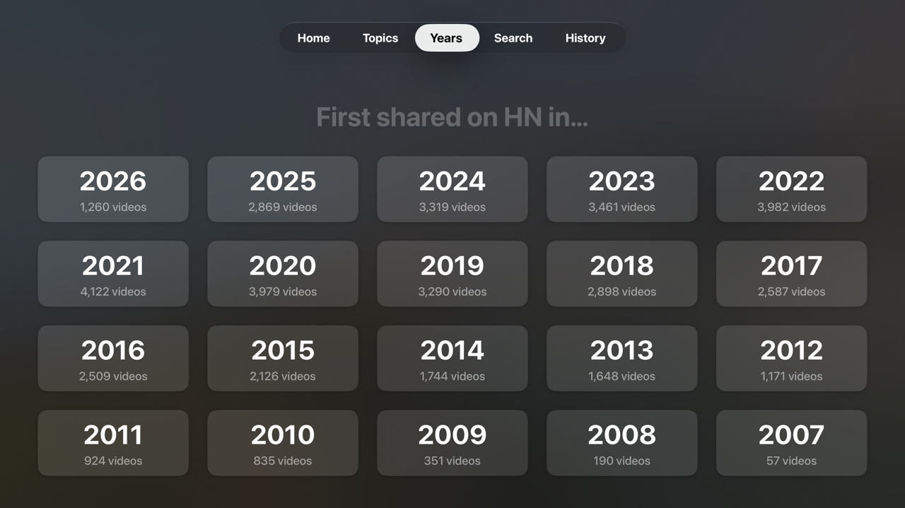

<p align="center"></p>

# HackerTube for Apple TV

YouTube videos that Hacker News recommends, on your TV.

People on Hacker News share great videos in their comments. Talks, lectures, documentaries, demos. This app collects them, ranks them, and shows them on Apple TV.

## Credit

The name and the idea come from **Andrej Karpathy**. He built [HackerTube](https://karpathy.bearblog.dev/hacker-tube/) as a website. This project is an Apple TV version of his idea, with a backend that updates itself.

## Screenshots





## What the app does

- **Home** shows rows: For You, Top of All Time, New on Hacker News, Popular This Year, and one row per topic.
- **Topics** groups videos into 30 subjects.
- **Years** lists videos by the year they were first shared on HN.
- **Search** looks through titles, channels and HN threads.
- **History** lists what you played.

Each video page shows:

- how many people shared it on HN;
- when it was first mentioned;
- the HN thread and a comment about it;
- related videos from the same HN threads.

Press **Play on YouTube** and the video opens in the YouTube app. tvOS has no web view, so the app can't play YouTube videos itself.

## How the system works

```
Hacker News ──> Backend (home server) ──> Static files on Cloudflare ──> Apple TV app
                  find YouTube links         hackernews.jagular.io          downloads files
                  get titles                                                 plays in YouTube app
                  sort into topics (local LLM)
                  publish every 3 hours
```

There are three parts.

### 1. The backend

The backend runs on a home server. It is not in this repo. It does six jobs.

**Backfill (once).** It downloaded the full Hacker News archive. That is about 49 million stories and comments. It searched them all for YouTube links. It found 257,000 videos in 407,000 mentions.

**Ingest (every 15 minutes).** It reads new items from the official Hacker News API. It looks for YouTube links in each story and comment. It saves who shared the link, when, and in which thread. It also updates the points of recent stories.

**Titles (every 15 minutes).** New videos need a title and a channel name. The backend asks YouTube for them. It also re-checks old videos every 45 days. Deleted or private videos drop out.

**Filter.** Not every link is a recommendation. A video is published if any of these is true:

- two or more different people shared it;
- it was posted as an HN story that scored 10+ points;
- someone mentioned it in the last 30 days.

About 43,000 videos pass.

**Rank.** Each video gets a score. More people sharing it means a higher score. Story points add to it. Recent mentions add a small boost.

**Publish (every 3 hours).** The backend writes the data as small JSON files. It uploads them to Cloudflare. If nothing changed, it skips the upload.

### 2. The topic classifier

Each video gets one topic, such as Programming, Space & Astronomy or Music. There are 30 topics.

A language model does this. It is Qwen, running on a local GPU. No cloud AI is used.

Here is how it works:

1. The backend picks videos that have no topic yet.
2. It sends 40 videos at a time to the model.
3. For each video, it sends the title, the channel, the HN thread title and a short HN comment. The extra context helps with vague titles.
4. The model replies with one line of 40 numbers. One topic number per video.
5. The backend checks the answer. If the count is wrong, it drops the batch. Those videos are tried again later.
6. Each batch takes about 8 seconds.

New videos get their topic in the next 3-hour publish run.

### 3. The data on Cloudflare

The app only downloads static files. No server code runs when you use the app. So serving the app costs nothing, however many people use it.

```
/v1/manifest.json              list of current files (checked often)
/v1/s/top.<hash>.json          the top 500 videos
/v1/s/m-2026-10.<hash>.json    videos first shared in that month
/v1/s/topics.<hash>.json       topic names
```

Each file name contains a hash of its content. A file never changes. When data changes, a new file with a new name appears. Old files can be cached forever.

### Daily updates

| When | What happens |
|---|---|
| Every 15 minutes | New HN items are read. New videos get titles. |
| Every 3 hours | New videos get topics. Scores are updated. Changed files are uploaded. |
| Every 45 days per video | Each video is re-checked. Dead videos are removed. |

A video shared on HN today reaches the app within about 3 hours.

### How the app stays up to date

- The app checks the manifest when it starts.
- It checks again when you return to it, if the last check is over 30 minutes old.
- It only downloads files whose names changed. Usually that is one or two small files.
- On first launch it gets the top 500 and the last 12 months. Older months load in the background.
- Everything is saved on the device. The app works offline with the last data it saw.

### Privacy

- No accounts. No sign-in. No tracking.
- Your history stays on your Apple TV.
- **For You** is worked out on the device, from the topics you watch and related videos.

## Build it yourself

### What you need

- A Mac with Xcode 16 or newer.
- An Apple TV (4K or HD) with tvOS 17 or newer.
- The YouTube app on the Apple TV.
- An Apple ID. A free one works.

### 1. Pair your Apple TV with Xcode

1. Put the Mac and the Apple TV on the same network.
2. On the Apple TV, open **Settings > Remotes and Devices > Remote App and Devices**.
3. On the Mac, open Xcode, then **Window > Devices and Simulators**.
4. Pick your Apple TV and enter the code it shows.

### 2a. Build in Xcode (easiest)

1. Open `HackerTube.xcodeproj`.
2. Click the **HackerTube** target, then **Signing & Capabilities**.
3. Pick your team. Change the bundle ID to something unique, such as `com.yourname.hackertube`.
4. Choose your Apple TV as the run destination.
5. Press **Run**.

### 2b. Build from the command line

Install XcodeGen once:

```bash
brew install xcodegen
```

Find your team ID in **Xcode > Settings > Accounts**. Find your Apple TV's ID:

```bash
xcrun devicectl list devices
```

Then build and install:

```bash
./build-and-install.sh <TEAM_ID> <DEVICE_ID>
```

You can add a third argument for your own bundle ID.

### About free Apple IDs

- Apps signed with a free Apple ID stop working after **7 days**. Build and install again to renew.
- A paid Apple Developer account gives you one year.

## Use your own backend

The app reads from `https://hackernews.jagular.io/v1/`. To use your own data, change one line in `App/Config.swift`. Your server must serve the same files as described above.

## Project layout

| Path | What |
|---|---|
| `App/` | SwiftUI source |
| `App/Config.swift` | data address |
| `Assets.xcassets/` | icon and Top Shelf images |
| `tools/make_art.py` | draws the icon (`python3 tools/make_art.py`) |
| `project.yml` | XcodeGen project file |
| `build-and-install.sh` | build and install script |

## Data and licences

- Hacker News data comes from the [open-index/hacker-news](https://huggingface.co/datasets/open-index/hacker-news) archive (ODC-BY) and the official [Hacker News API](https://github.com/HackerNews/API).
- Video titles and thumbnails come from YouTube. Videos play in the official YouTube app.
- This project is not affiliated with Y Combinator, Hacker News, YouTube or Google.
- Code licence: MIT. See [LICENSE](LICENSE).
